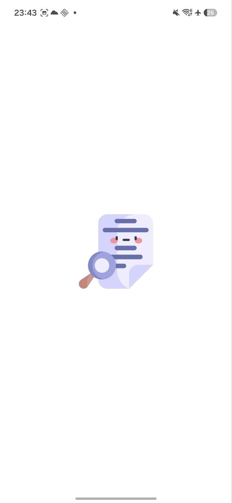
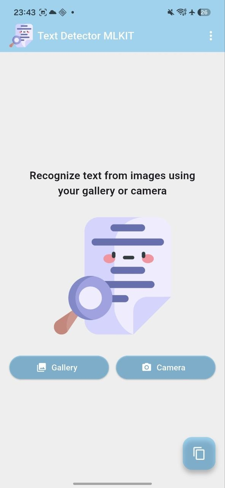
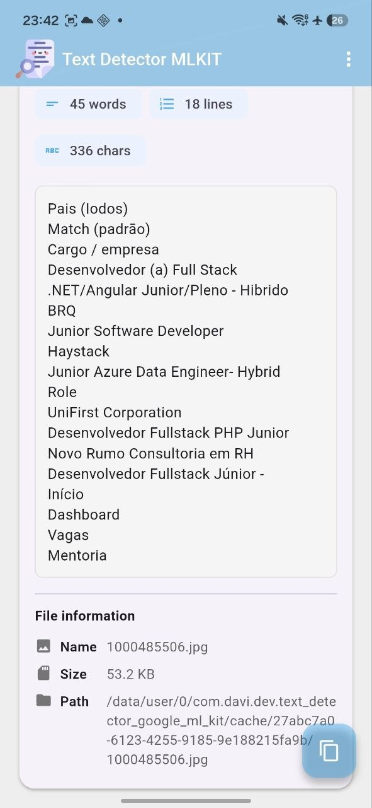
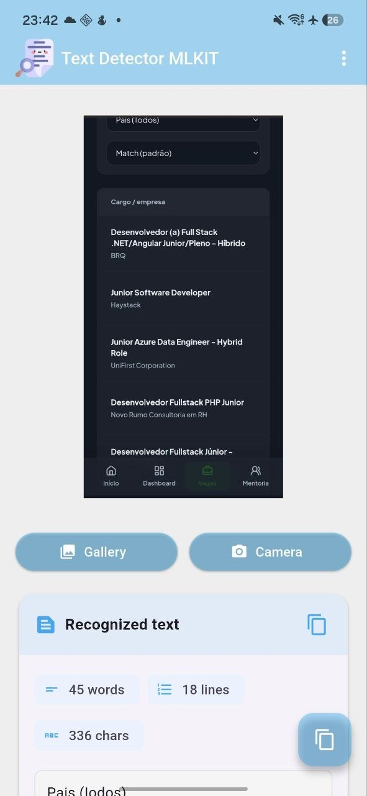

# App de detecção de texto com o Kit de Machine Learning do Google

## Novidades - Versão 3.0.2

- Nova tela de splash com a logo do app animada
- Tela inicial redesenhada: conteúdo centralizado e descrição do app acima da logo
- Resultado da detecção exibido em um card, com botão de copiar, contagem de palavras, linhas e caracteres, texto selecionável e informações do arquivo (nome, tamanho e caminho)
- `targetSdk` do Android elevado para 36

### Versão 3.0.0

- Atualização de todas as dependências Flutter (Google ML Kit, Camera, Image Picker, Package Info Plus, Flutter Lints, entre outras)
- Build Android migrado para **Android Gradle Plugin 9.0.1** e **Gradle 9.1.0**
- Ajustes no pipeline de CI/CD (GitHub Actions)

Veja o histórico completo de mudanças em [CHANGELOG.md](CHANGELOG.md).

## Descrição

Projeto desenvolvido para demonstrar a utilização da API que reconhece textos do Kit ML para Flutter do Google.

Neste projeto uso o **KitML para Flutter do Google**, **ImagePicker**, **Path Provider** e **Camera**.

## Funcionalidades

- Reconhecimento de texto em imagens da galeria ou tiradas com a câmera
- Reconhecimento de texto em tempo real pela câmera
- Cópia do texto reconhecido para a área de transferência
- Estatísticas do texto detectado (palavras, linhas e caracteres) e informações do arquivo analisado
- Tela de splash animada, política de privacidade e página "Sobre"

## Tecnologias utilizadas

<p>


</p>

## Dependências Flutter utilizadas

O **Kit ML para Flutter do Google** que é um conjunto de plugins Flutter que permitem que os aplicativos usem o Kit ML autônomo do Google.

- [Reconhecimento de texto do Kit ML do Google para flutter](https://github.com/bharat-biradar/Google-Ml-Kit-plugin/tree/master/packages/google_mlkit_text_recognition)

Um plugin Flutter para usar o ML Kit Text Recognition do Google para reconhecer texto em qualquer conjunto de caracteres chinês, Devanagari, japonês, coreano e latino.

- [Image Picker](https://pub.dev/packages/image_picker)

**ImagePicker** é um plug-in Flutter para iOS e Android para escolher imagens da biblioteca de imagens e tirar novas fotos com a câmera

- [Path Provider](https://pub.dev/packages/path_provider)

**Path Provider** é um plug-in flutter para encontrar locais comumente usados no sistema de arquivos. Suporta Android, iOS, Linux, macOS e Windows

- [Camera](https://pub.dev/packages/camera)

**Camera** é um plugin Flutter para iOS, Android e Web permitindo acesso às câmeras do dispositivo.

## Preview

<div>


</div>

<div>


</div>

## Como executar

Pré-requisitos: Flutter (canal `stable`), JDK 21 e Android SDK 36.

```bash
flutter pub get
flutter run
```

Para gerar o APK de release:

```bash
flutter build apk --release
```

## Começando

Este projeto é um ponto de partida para uma aplicação Flutter.

Alguns recursos para você começar se este for seu primeiro projeto Flutter:

- [Lab: Escreva seu primeiro aplicativo Flutter](https://docs.flutter.dev/get-started/codelab)
- [Cookbook: exemplos úteis do Flutter](https://docs.flutter.dev/cookbook)

Para obter ajuda para começar com o desenvolvimento do Flutter, consulte o
[documentação online](https://docs.flutter.dev/), que oferece tutoriais,
exemplos, orientação sobre desenvolvimento móvel e uma referência completa de API.
